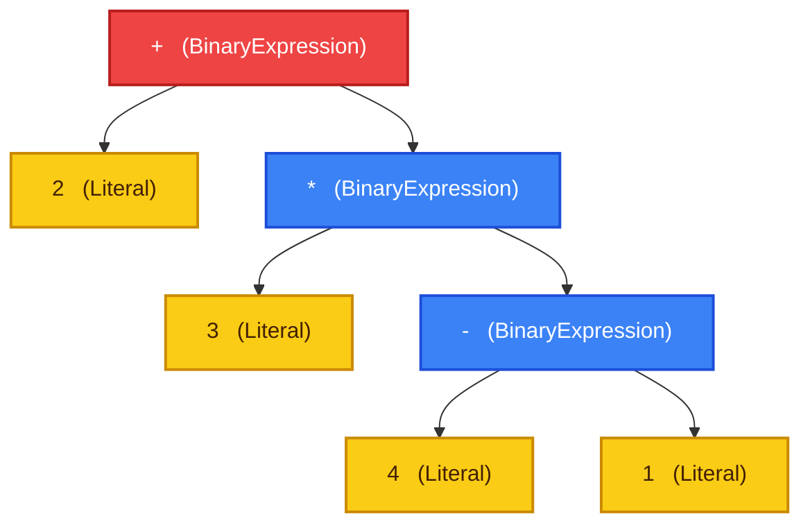
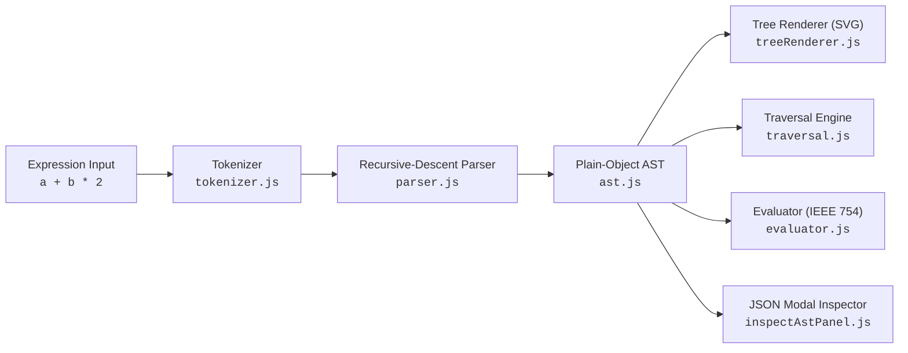

# ParseVision

> An interactive Abstract Syntax Tree generator, visualizer, and expression evaluator.

ParseVision is an educational, browser-based developer tool designed for exploring compiler frontend fundamentals and syntax tree analysis. It accepts arithmetic and algebraic expressions, tokenizes and parses them through a deterministic recursive-descent parser, and renders the resulting Abstract Syntax Tree (AST) onto an interactive, coordinate-plane SVG canvas.

Users can step through canonical tree traversal algorithms (Preorder, Inorder, Postorder) with animated playback, inspect node properties with real-time diagnostics, evaluate expressions using standard IEEE 754 floating-point arithmetic, examine syntax-highlighted AST JSON schemas, and export diagrams directly from the browser.

<!-- Application screenshot placeholder: add a verified image when published -->
<!-- <p align="center"></p> -->

## 1. Overview

Understanding how source code transitions from raw text into hierarchical syntax trees is a core concept in compiler construction and language design. ParseVision provides a visual, zero-dependency environment for exploring this translation pipeline.

The application addresses common conceptual challenges in syntax analysis, including:

- **Operator Precedence and Associativity:** Visualizing how multiplicative operations bind tighter than additive operations, and how left-associativity builds left-skewed subtrees.
- **Explicit Grammar Adherence:** Demonstrating how formal, non-left-recursive grammar rules guide recursive-descent parsing functions.
- **Tree Traversal Sequences:** Comparing depth-first visit orders (Preorder, Inorder, Postorder) with animated node highlighting and sequential visit counters.
- **Concrete AST Representations:** Providing a transparent, plain-object JSON schema that mirrors the in-memory representation used by compilers.

## 2. Features

### Parsing and Grammar
- **Deterministic Recursive-Descent Parser:** Implements LL(1) recursive-descent parsing driven by a formal, non-left-recursive arithmetic grammar.
- **Operator Precedence and Associativity:** Correctly reflects standard algebraic precedence (`*` and `/` over `+` and `-`) with left-associative chaining.
- **Prefix Unary Operators:** Full support for unary plus (`+`) and unary minus (`-`) operators binding directly to primary operands.
- **Sub-Expression Grouping:** Nested parentheses `( ... )` explicitly override operator precedence and establish isolated subtree boundaries.

### AST Visualization and Inspection
- **Interactive SVG Canvas:** Renders hierarchical tree layouts with mathematically calculated coordinates and smooth cubic bezier connector curves.
- **Semantic Color Coding:** Categorizes nodes by role using distinctive color tokens (Root, BinaryExpression, UnaryExpression, Identifier, and Literal).
- **Collision-Free Geometry:** Recursively computes subtree bounding widths to ensure uniform node sizing (64×64 px) without overlapping cards or connectors.
- **Single-Node Inspection:** Clicking any node highlights it with an active selection ring and displays its semantic type and properties via a toast notification.

### Traversal and Playback
- **Three Traversal Algorithms:** Full support for **Preorder** ($Node \to Left \to Right$), **Inorder** ($Left \to Node \to Right$), and **Postorder** ($Left \to Right \to Node$) depth-first traversals.
- **Interactive Playback Controls:** Play, Pause, and Replay controls step through traversal sequences node-by-node.
- **Configurable Playback Speeds:** Switch between `1x` (800 ms/step), `1.5x` (533 ms/step), and `2x` (400 ms/step) execution speeds.
- **Synchronized Visual Feedback:** Sequential visit badges (`1`, `2`, `3`...) and a pulsing selection ring track traversal progression alongside a live step counter.

### Expression Evaluation and Diagnostics
- **IEEE 754 Math Evaluation:** Evaluates pure numerical ASTs in accordance with standard floating-point arithmetic rules, including standard division-by-zero behaviors (`Infinity`, `-Infinity`).
- **Targeted Character-Offset Diagnostics:** Reports lexical and syntax errors with zero-based source position offsets (e.g., `at character 7.`) while immediately clearing invalid tree states.
- **Canonical Presets:** Preloaded with canonical expressions demonstrating precedence, unary signs, nested parentheses, and associativity.

### Navigation, Export, and Responsive Interaction
- **Coordinate Viewport Navigation:** Drag-to-pan canvas exploration, `Ctrl + Wheel` zooming centered on cursor position, discrete zoom controls (`+`, `-`, `100%`), and auto-fitting (`F`).
- **AST JSON Inspector Modal:** Dedicated dialog displaying formatted, syntax-highlighted plain JSON with node count metrics, payload byte calculations, and one-click clipboard copying.
- **High-Resolution PNG Export:** Client-side rasterization and download of the rendered syntax tree diagram as `parsevision-ast.png`.
- **Responsive Layout:** Adaptive design scaling smoothly from mobile viewports (with an enforced minimum initial zoom floor of 75% for legibility) up to desktop displays.

## 3. Example: Expression to AST

Consider the arithmetic expression:

```text
2 + 3 * (4 - 1)
```

### Precedence and Hierarchy

1. **Root Operation (`+`):** Because multiplication has higher precedence than addition, the root of the tree is the additive operator `+`. Its left operand is the numeric literal `2`.
2. **Right Subtree (`*`):** The right operand of `+` is the multiplicative operation `3 * (4 - 1)`.
3. **Parenthesized Sub-Expression (`-`):** Within the multiplication, the parentheses around `(4 - 1)` establish an explicit boundary. The subtraction operation `4 - 1` is evaluated first, placing `-` as the right child of `*`.



### Evaluation Result

Evaluating this tree yields **`11`**:

1. Evaluate left operand of root `+`: `2`
2. Evaluate right operand of root `+` (`3 * (4 - 1)`):
   - Evaluate left operand of `*`: `3`
   - Evaluate right operand of `*` (`4 - 1`):
     - `4 - 1 = 3`
   - Compute multiplication: `3 * 3 = 9`
3. Compute root addition: `2 + 9 = 11`

### AST JSON Schema

The recursive-descent parser generates plain JavaScript objects conforming to the following structure:

```json
{
  "type": "BinaryExpression",
  "operator": "+",
  "left": {
    "type": "Literal",
    "value": 2,
    "raw": "2"
  },
  "right": {
    "type": "BinaryExpression",
    "operator": "*",
    "left": {
      "type": "Literal",
      "value": 3,
      "raw": "3"
    },
    "right": {
      "type": "BinaryExpression",
      "operator": "-",
      "left": {
        "type": "Literal",
        "value": 4,
        "raw": "4"
      },
      "right": {
        "type": "Literal",
        "value": 1,
        "raw": "1"
      }
    }
  }
}
```

### Traversal Sequences

For this expression, the traversal algorithms produce the following visit orders:

| Algorithm | Traversal Order | Visit Sequence |
|---|---|---|
| **Preorder** | Node → Left → Right | `+` → `2` → `*` → `3` → `-` → `4` → `1` |
| **Inorder** | Left → Node → Right | `2` → `+` → `3` → `*` → `4` → `-` → `1` |
| **Postorder** | Left → Right → Node | `2` → `3` → `4` → `1` → `-` → `*` → `+` |

## 4. Supported Syntax

### Formal Grammar

ParseVision's parser implements an unambiguous, non-left-recursive arithmetic grammar:

```text
E  → T E'
E' → + T E' | - T E' | ε
T  → U T'
T' → * U T' | / U T' | ε
U  → + U | - U | P
P  → ( E ) | id | num
```

- Non-terminals: `E` (expression), `E'` (additive continuation), `T` (term), `T'` (multiplicative continuation), `U` (unary expression), `P` (primary expression).
- Terminals: `+`, `-`, `*`, `/`, `(`, `)`, `id` (identifier), `num` (numeric literal), `ε` (empty production).

### Supported Language Constructs

| Construct | Syntax | Example | Description |
|---|---|---|---|
| **Addition** | `+` | `a + b` | Infix binary addition, left-associative |
| **Subtraction** | `-` | `a - b` | Infix binary subtraction, left-associative |
| **Multiplication** | `*` | `a * b` | Infix binary multiplication, left-associative |
| **Division** | `/` | `a / b` | Infix binary division, left-associative |
| **Unary Plus** | `+` | `+a` | Prefix unary sign, preserves operand value |
| **Unary Minus** | `-` | `-a` | Prefix unary negation |
| **Parentheses** | `( ... )` | `(a + b) * c` | Grouping override for operator precedence |
| **Numeric Literals** | `\d+`, `\d*\.\d+` | `42`, `3.14`, `.5`, `5.` | Integer and decimal numbers with digits on either side of decimal point |
| **Identifiers** | `[A-Za-z_][A-Za-z0-9_]*` | `x`, `total`, `item_count` | Variable and symbol names |

### Operator Precedence and Associativity

| Precedence | Level | Operator | Associativity | Description |
|---|---|---|---|---|
| **Highest** | 4 | `( )`, `id`, `num` | None | Grouping parentheses, variable identifiers, numeric literals |
| | 3 | `+` (unary), `-` (unary) | Right-to-Left (Prefix) | Prefix positive and negation signs |
| | 2 | `*`, `/` | Left-to-Right | Multiplicative operations |
| **Lowest** | 1 | `+`, `-` | Left-to-Right | Additive operations |

### Unsupported Syntax

ParseVision is designed specifically for arithmetic expression parsing. The following constructs are outside the language grammar and are intercepted with targeted lexical or syntax diagnostics:

- **Modulo and Exponentiation:** `%`, `**`, and `^` are identified as unsupported operators.
- **Programming Language Constructs:** Variable assignments (`=`), comparison operators (`==`, `<`), logical operators (`&&`, `||`), bitwise operators, control-flow statements (`if`, `while`), and function calls are not supported.

## 5. AST Node Model

The parser generates four plain JavaScript object node types. Each node represents a distinct syntactic unit without circular references or DOM coupling.

### Node Definitions

#### 1. `BinaryExpression`
Represents an infix binary operation connecting two subtrees:
- `type`: `"BinaryExpression"`
- `operator`: `"+"` | `"-"` | `"*"` | `"/"`
- `left`: Child AST node
- `right`: Child AST node

#### 2. `UnaryExpression`
Represents a prefix unary operator applied to a single operand:
- `type`: `"UnaryExpression"`
- `operator`: `"+"` | `"-"`
- `argument`: Child AST node

#### 3. `Identifier`
Represents a variable or symbol name:
- `type`: `"Identifier"`
- `name`: String identifier name (e.g., `"x"`, `"total"`)

#### 4. `Literal`
Represents a concrete numeric value:
- `type`: `"Literal"`
- `value`: Evaluated numeric value as an IEEE 754 number (e.g., `42`, `3.14`)
- `raw`: Source string representation as parsed (e.g., `"42"`, `".5"`)

> **Node Schema Clarification:** In the underlying AST data structure emitted by `ast.js` and `parser.js`, numeric nodes have `type: "Literal"`. In the canvas UI legend and toast inspection labels, they are presented as **`NumericLiteral`** to make their numeric nature immediately evident to users. The evaluator and visualizer accept both types interchangeably.

### Visual Color Tokens

Each node type is visually distinguished on the canvas using semantic tokens:

| Category | Label in UI | Fill Color | Border / Stroke | Role |
|---|---|---|---|---|
| **Root Node** | `Root Node` | `#EF4444` | `#B91C1C` | Entry point of the evaluated AST |
| **BinaryExpression** | `BinaryExpression` | `#3B82F6` | `#1D4ED8` | Infix binary operators (`+`, `-`, `*`, `/`) |
| **UnaryExpression** | `UnaryExpression` | `#F97316` | `#C2410C` | Prefix unary operators (`+`, `-`) |
| **Identifier** | `Identifier` | `#22C55E` | `#15803D` | Variables and symbol names |
| **Literal** | `NumericLiteral` | `#FACC15` | `#CA8A04` | Concrete numeric constants |

## 6. Architecture and Processing Pipeline

ParseVision cleanly separates syntax analysis, evaluation, and user interface rendering:



### Module Responsibilities

- **`tokenizer.js`:** Performs lexical analysis on the input string, producing a stream of tokens (`NUMBER`, `IDENTIFIER`, `OPERATOR`, `PAREN`, `EOF`) while tracking zero-based character offsets (`start`, `end`).
- **`grammar.js`:** Declares the formal grammar, operator sets, and precedence lookup tables used across parser and tokenizer modules.
- **`parser.js`:** Executes deterministic recursive-descent parsing. Implements `parseExpression`, `parseEPrime`, `parseTerm`, `parseTPrime`, `parseUnary`, and `parsePrimary` to build the AST.
- **`ast.js`:** Factory functions (`binaryExpression`, `unaryExpression`, `identifier`, `literal`) that validate inputs and construct plain-object AST nodes.
- **`evaluator.js`:** Recursively evaluates the AST using standard arithmetic rules and optional environment maps for identifier resolution.
- **`traversal.js`:** Implements pure, cycle-checked preorder, inorder, and postorder traversal functions.
- **`treeRenderer.js`:** Calculates tree layout coordinates, dimensions subtrees to avoid overlap, renders cubic bezier SVG connectors, and exports canvas trees to PNG.
- **`nodeStyles.js`:** Centralizes visual styling tokens, dimensions, legend definitions, and traversal badge colors.
- **`editor.js`, `outputPanel.js`, `inspectAstPanel.js`, `toast.js`:** UI components managing user input, canvas interaction, JSON inspection, and feedback notifications.

## 7. Interaction Guide

### Viewport Navigation
- **Pan:** Click and drag anywhere on the canvas background to pan the coordinate plane.
- **Zoom:** Use the `+` and `-` toolbar buttons, or hold `Ctrl` (or `Cmd`) while scrolling with your mouse wheel or trackpad.
- **Reset Zoom:** Click the `100%` button to restore default zoom and center the tree.
- **Fit to View:** Press `F` or trigger fit-to-view to automatically scale and center the active tree within the viewport boundaries.

### Traversal Playback
- **Select Traversal Mode:** Toggle between **Preorder**, **Inorder**, and **Postorder** using the radio buttons in the canvas toolbar.
- **Playback Controls:** Use the **Play** button to begin animated traversal, **Pause** to hold the current step, or **Replay** to restart from step 1.
- **Speed Adjustment:** Select between `1x` (normal), `1.5x` (fast), or `2x` (high speed) at any point during playback.
- **Progress Tracking:** Monitor traversal progress via the live step indicator (e.g., `3 / 7`), visited node badges (`1`, `2`, `3`...), and the active node's pulsing highlight ring.

### Node Inspection and JSON Export
- **Inspect Nodes:** Click any node card on the canvas to display its category and properties in a toast notification and apply an active focus ring.
- **Inspect AST JSON:** Click the **`code`** icon in the header toolbar to open the AST modal, showing formatted, syntax-highlighted JSON, node counts, and payload byte size.
- **Copy JSON:** Click **Copy JSON** inside the inspector dialog to copy the formatted AST directly to your clipboard.
- **Export PNG:** Click **Export PNG** in the header to download a 300 DPI rasterized PNG image (`parsevision-ast.png`) of the current tree.

### Keyboard Shortcuts

| Shortcut | Context | Action |
|---|---|---|
| `Ctrl + Enter` / `Cmd + Enter` | Expression Editor | Generate AST from input expression |
| `Escape` | Inspect AST Modal | Close the inspection dialog |
| `ArrowUp` / `ArrowDown` | Focused Canvas Viewport | Pan canvas vertically (±50 px) |
| `ArrowLeft` / `ArrowRight` | Focused Canvas Viewport | Pan canvas horizontally (±50 px) |
| `+` or `=` | Focused Canvas Viewport | Zoom in (+25%) |
| `-` or `_` | Focused Canvas Viewport | Zoom out (-25%) |
| `0` | Focused Canvas Viewport | Reset zoom to 100% |
| `F` or `f` | Focused Canvas Viewport | Fit and center tree to viewport |
| `ArrowLeft` / `ArrowRight` | Traversal Mode Group | Switch between Preorder, Inorder, and Postorder |

## 8. Technology Stack

ParseVision is engineered using modern, native web standards with zero runtime dependencies:

- **Language:** JavaScript (ES modules, `"type": "module"`).
- **Visualization:** Scalable Vector Graphics (SVG) for cubic bezier connector curves and responsive coordinate layout.
- **Markup and Styling:** Semantic HTML5 and CSS3 with custom design tokens, responsive media queries, and neumorphic depth styling.
- **Typography and Icons:** Google Fonts (*Inter*, *JetBrains Mono*) and Google *Material Symbols Outlined*.
- **Tooling and Bundling:** [Vite 7](https://vite.dev/) as the development server and production bundler (sole development dependency).
- **Zero Frontend Frameworks:** No React, Vue, or Svelte; no external graphing libraries (D3, Cytoscape); and no backend server or database. All parsing, evaluation, and rendering execute locally in the browser runtime.

## 9. Getting Started

### Prerequisites

- [Node.js](https://nodejs.org/) version **20.19+** or **22.12+** (LTS recommended, required by Vite 7)
- `npm` (included with Node.js)

### Installation

Clone the repository and install the development dependencies:

```bash
git clone <REPOSITORY_URL>
cd ParseVision
npm install
```

### Development Server

Start Vite's local development server:

```bash
npm run dev
```

Open the displayed local URL (typically `http://127.0.0.1:5173/`) in any modern web browser.

### Production Build

Compile and bundle the application assets for production:

```bash
npm run build
```

The compiled bundle will be output to the `dist/` directory.

### Preview Production Build

To test the production build locally:

```bash
npx vite preview
```

## 10. Project Structure

```text
ParseVision/
├── index.html                 # HTML shell, web fonts, and application mount point
├── package.json               # Project metadata, Vite dependency, and build scripts
├── vite.config.js             # Vite development server and watcher configuration
└── src/
    ├── main.js                # Application entry point and component orchestration
    ├── parser/
    │   ├── grammar.js         # Formal grammar definition and operator sets
    │   ├── tokenizer.js       # Lexical analyzer with character-offset tracking
    │   ├── ast.js             # AST node factory functions and structural assertions
    │   ├── parser.js          # Recursive-descent parser producing plain-object ASTs
    │   └── evaluator.js       # Arithmetic expression evaluator (IEEE 754 math)
    ├── traversal/
    │   └── traversal.js       # Preorder, Inorder, and Postorder traversal algorithms
    ├── visualizer/
    │   ├── nodeStyles.js      # Semantic color tokens, dimensions, and legend configuration
    │   └── treeRenderer.js    # Tree layout engine, SVG bezier curves, and PNG export
    ├── components/
    │   ├── editor.js          # Expression input toolbar, presets, and diagnostic status bar
    │   ├── outputPanel.js     # AST visualization canvas, pan/zoom engine, and playback controls
    │   ├── inspectAstPanel.js # Collapsible AST JSON modal dialog with syntax highlighting
    │   └── toast.js           # Lightweight floating toast notification utility
    └── styles/
        └── style.css          # Design system stylesheet and responsive styling
```

## 11. Scope and Limitations

ParseVision is designed as an educational tool focused on arithmetic expressions and syntax tree visualization. The following boundaries reflect its intentional scope:

- **Arithmetic Scope:** The parser does not support full programming language constructs such as variable assignments (`x = 5`), statements, conditionals (`if`/`else`), loops, functions, or block scopes.
- **Identifier Evaluation:** Variable identifiers (e.g., `a`, `b`, `total`) are valid AST nodes and render correctly in trees. However, evaluating expressions containing identifiers requires an environment bindings map. Evaluating without providing bindings throws a reference error.
- **Division by Zero:** Division by zero (e.g., `10 / 0`) is grammatically valid and correctly rendered in the AST. In accordance with IEEE 754 float semantics, expression evaluation returns `Infinity` or `-Infinity`.
- **Client-Side Execution:** The application executes entirely client-side in the browser runtime; no user data is transmitted to external servers.

## 12. Potential Extensions

The following ideas represent natural architectural extensions for future exploration:

- **Dynamic Environment Binding:** An interactive variable binding editor allowing users to assign numeric values to identifiers and evaluate algebraic expressions dynamically.
- **Step-by-Step AST Evaluation:** An animated reduction mode showing subtrees collapsing step-by-step into computed numerical values.
- **Exponentiation Support:** Introducing a right-associative exponentiation operator (`^` or `**`) to demonstrate right-associative grammar rules and parsing.
- **Breadth-First (Level-Order) Traversal:** Adding level-order traversal alongside depth-first traversal algorithms.
- **Interactive Grammar Explorer:** An interactive rule inspection panel demonstrating which grammar production applies at each parsing step.

## 13. License

This project does not currently specify an open-source license. All rights are reserved by the author. If you wish to use or contribute to this codebase, please contact the repository owner.
